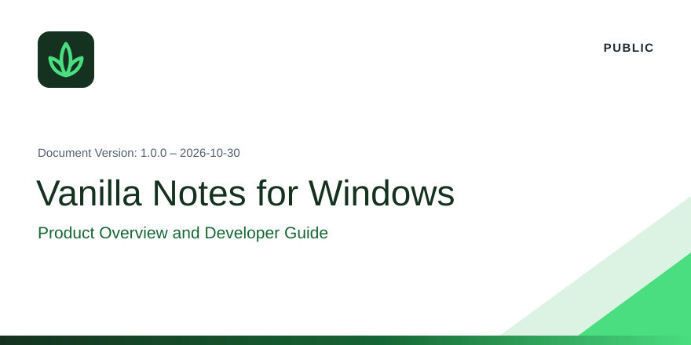

## Content

1. [Overview](#1-overview)
2. [Key Capabilities](#2-key-capabilities)
3. [System Requirements](#3-system-requirements)
4. [Getting Started](#4-getting-started)
5. [Documentation](#5-documentation)
6. [Document History](#6-document-history)

[Important Disclaimers and Legal Information](#important-disclaimers-and-legal-information)

---

## 1 Overview

Vanilla Notes is a Markdown notes application for Windows. Notes are stored on the user's computer: there is no account and no server, and the application opens no connection.

> [!IMPORTANT]
> Version 1.0.0 is a pre-release and is not yet published.

 

## 2 Key Capabilities

| Area | Capability |
|---|---|
| Writing | Visual editor, Markdown source with coloring, and reading view |
| Organization | Folders, tags, pinned notes, and full-text search |
| Privacy | Password-protected profiles, encrypted on disk, with a recovery code and Windows Hello |
| Data safety | Trash kept for 30 days, and daily backups with restore |
| Exchange | Attachments, export to Markdown or web pages, printing, and import of `.md` files |
| Interface | English and Spanish; light, neutral, dark, and high-contrast themes |

 

## 3 System Requirements

| Item | Requirement |
|---|---|
| Operating system | Windows 10 version 2004 (build 19041) or later |
| Processor | x64 or Arm64 |
| To build | The .NET SDK pinned in `global.json` |

 

## 4 Getting Started

| Task | Command |
|---|---|
| Build | `dotnet build VanillaNotes.slnx` |
| Test | `dotnet test` |
| Run | `dotnet run --project src/VanillaNotes.App` |

> [!NOTE]
> A copy run from source uses the same data folder as an installed copy, `%APPDATA%\Vanilla Notes\`.

 

## 5 Documentation

| Topic | Reference |
|---|---|
| Index of all documents | [docs/README.md](docs/README.md) |
| Scope and repository structure | [docs/01-project/definition.md](docs/01-project/definition.md) |
| Architecture | [docs/03-architecture/overview.md](docs/03-architecture/overview.md) |
| Changes by version | [docs/CHANGELOG.md](docs/CHANGELOG.md) |

 

## 6 Document History

| Version | Date | Change |
|---|---|---|
| 1.0.0 | 2026-10-30 | First version of this document |

---

 

## Important Disclaimers and Legal Information

Copyright (C) 2026 Kev Martínez. Vanilla Notes is free software, provided with no warranty.

| Item | Reference |
|---|---|
| License | [GNU Affero General Public License, version 3 or later](LICENSE) |
| Additional terms and attribution | [NOTICE](NOTICE) |
| Privacy policy | [docs/legal/privacy-policy.txt](docs/legal/privacy-policy.txt) |
| Third-party software | [docs/legal/third-party-notices.txt](docs/legal/third-party-notices.txt) |

<b>PUBLIC</b> · Vanilla Notes for Windows · Product Overview and Developer Guide

